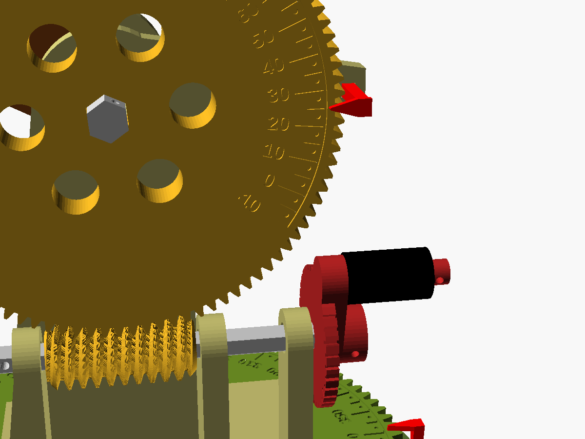

# Canhão de brinquedo: reparo com coroa e rosca sem fim (v2, 100:1)

Arquivo único: [`artilharia.scad`](artilharia.scad), 100% paramétrico e sem bibliotecas externas.
STLs prontos de todas as peças em [`stl/`](stl/). Tudo junto em `canhao_completo.zip`.

## Como funciona

| Eixo | Acionamento | Redução | 1 volta da manivela | 1 marca do tambor |
|---|---|---|---|---|
| **Azimute** (horizontal) | rosca sem fim na base fixa → coroa de **100 dentes**, que é a própria **mesa giratória** | **100 : 1** | 3,6° | **0,1°** |
| **Elevação** (vertical) | rosca sem fim no carro → coroa de **100 dentes** no munhão | **100 : 1** | 3,6° | **0,1°** |

- **Mesa giratória:** a coroa grande de azimute é a mesa (Ø153 mm). Ela roda sobre um rolamento axial
  caseiro (canal em V de 90° em cima e embaixo, com ~55 BBs de airsoft de 6 mm) e fica centrada por um rolamento
  **608** (de skate) com um pino de 8 mm. O carro, a elevação e o cano ficam todos em cima dela.
- **Elevação:** a coroa (Ø102 mm) fica do lado de fora da bochecha direita, no mesmo eixo sextavado do berço do cano.

### Escalas (nas duas coroas)

| Marca | Significado |
|---|---|
| traço longo + **número** | a cada **10°** |
| traço curto, sem número | a cada **5°** |
| **ponto** | no meio de cada 5°, ou seja, a cada **2,5°** |
| entalhe do tambor na manivela | **0,1°** (36 por volta; os longos marcam 0,5°) |

- **Azimute:** 0 a 350°, gravada no anel da mesa. O ponteiro fica preso na base.
- **Elevação:** −10° a 80°, gravada na face da coroa, como um transferidor. O ponteiro fica preso no braço da bochecha.
- **Leitura:** primeiro a escala grande (até 2,5°), depois o tambor completa até 0,1°. O braço da manivela é o "zero" do tambor.
  A seta gravada no mancal externo é o índice.

### Medidas das engrenagens

| | Coroa de azimute (mesa) | Coroa de elevação |
|---|---|---|
| Dentes / módulo | 100 / 1,5 | 100 / 1 |
| Ø externo / primitivo / pé | 153 / 150 / 146,25 mm | 102 / 100 / 97,5 mm |
| Espessura | 12 mm | 10 mm |
| Escala (raio externo dos traços) | 72 mm (1° ≈ 1,26 mm) | 47 mm (1° ≈ 0,82 mm) |

| | Rosca de azimute | Rosca de elevação |
|---|---|---|
| Ø externo × comprimento | 21 × 40 mm | 16 × 34 mm |
| Ângulo de avanço | 4,8° | 4,1° |

### Manivelas (revisadas)

- **3 mancais por eixo:** dois junto à rosca e um **mancal externo** que afasta a manivela. Assim ela gira
  livre e o eixo longo não flexiona.
- **Punho giratório** (peça `punho`) que roda solto no pino, para dar as muitas voltas sem esfolar a mão.
  Ele fica travado por um pedaço de filamento.
- **Cubo travado por pino:** o filamento atravessa o cubo e o eixo, então a manivela não sai nem patina.
- **Giro conferido sem colisão** no CGAL:
  - as duas manivelas em volta completa, com a mesa em 24 direções (a cada 15°) e o cano em toda a faixa de −10° a 80°;
  - a manivela de elevação passa **por cima** da manivela de azimute. É por isso que a rosca de elevação fica a 46 mm da mesa.

### Um pouco de teoria

**Por que rosca sem fim?** Uma rosca de 1 entrada avança **um dente da coroa por volta**, então
`i = Z_coroa / n_entradas = 100 / 1`. São 100:1 num único estágio, em vez de três pares de engrenagens retas.

**Autotravamento.** Com avanço `γ = atan(m/d)` de ~4–5° e `tan γ < μ` (μ ≈ 0,2–0,3 para PLA com PLA), a coroa
não consegue girar a rosca de volta. A pontaria fica travada sozinha e o cano não cai com o próprio peso.

**Coroa helicoidal.** A hélice da coroa é igual ao avanço da rosca (mesma mão), com os eixos cruzados a 90°. Conferi no
CGAL que rosca e coroa **não se interpenetram**, tanto paradas quanto girando juntas.

**Rolamento em V.** Uma esfera de raio r num V de 90° tem o centro a `r·√2` do vértice. Com o canal de 3,4 mm sobra
~1,7 mm de vão entre a base e a mesa, e as esferas se autocentralizam.

## Peças (troque `PARTE` no Customizer)

Cada peça já sai na orientação de impressão.

| `PARTE` | Qtd | Observação |
|---|---|---|
| `base` | 1 | ~186 × 172 mm, alívio cônico por baixo (45°, sem suporte) |
| `mesa` | 1 | Ø153, canal em V para baixo |
| `carro` | 1 | placa + bochechas + 3 mancais da elevação |
| `berco` | 1 | deitado de lado |
| `cano` | 1 | em pé (provisório) |
| `roda_el` | 1 | escala para cima |
| `rosca_az`, `rosca_el` | 1 cada | em pé |
| `manivela_az`, `manivela_el` | 1 cada | tambor na mesa, pino para cima |
| `punho` | **2** | |
| `eixo_az`, `eixo_el`, `eixo_munhao` | 1 cada | deitados (ou chave Allen 6 mm / 8 mm) |
| `ponteiro_az`, `ponteiro_el` | 1 cada | |
| `pino_pivo` | 1 | ou parafuso M8 |

**Material extra:** 1 rolamento 608, ~55 BBs de 6 mm, 4 parafusos M3 × 10, filamento 1,75 mm para os pinos-trava.

**Dica de impressão:** a escala da elevação tem traços de 0,8 mm e pontos de 1,2 mm. Use bico de 0,4 mm e camada de 0,12–0,16 mm no topo.
Também ajuda passar tinta na gravação e lixar a face depois.

## Montagem

1. Prense o 608 no centro da base e encha o canal com as BBs.
2. Pouse a mesa e passe o pino pivô (ou M8).
3. Rosca de azimute: passe o eixo pelos 3 mancais e pela rosca, encaixe a manivela e trave com filamento
   nas duas pontas (a da manivela atravessa o cubo).
4. Parafuse o carro na mesa **antes** de montar a rosca de elevação.
5. Rosca de elevação, eixo e manivela, do mesmo jeito.
6. Berço entre as bochechas, coroa do lado de fora, eixo do munhão e trava.
7. Encaixe os ponteiros. Para calibrar, gire a coroa no eixo até o "0" bater com o cano na horizontal.

## Próximo passo

O mecanismo de disparo ainda não existe. O `cano()` é um tubo de Ø18 encaixado num soquete do berço
(Ø18,4 × 12 mm). Dá para trocar só ele.

