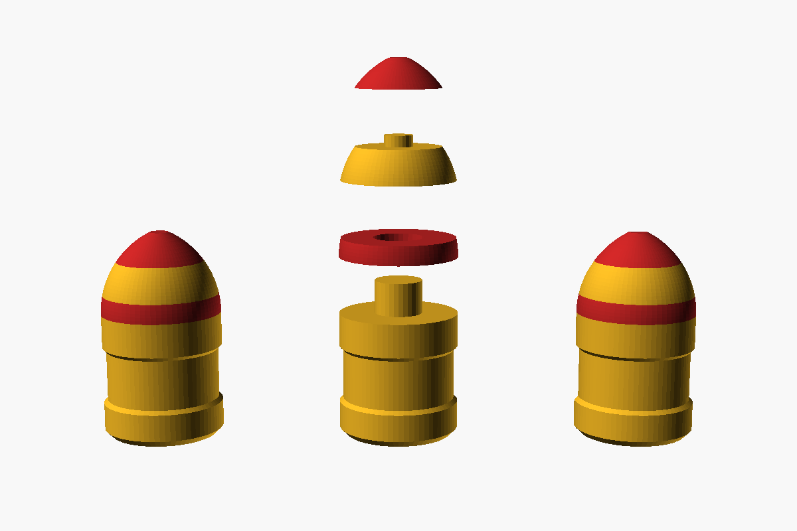
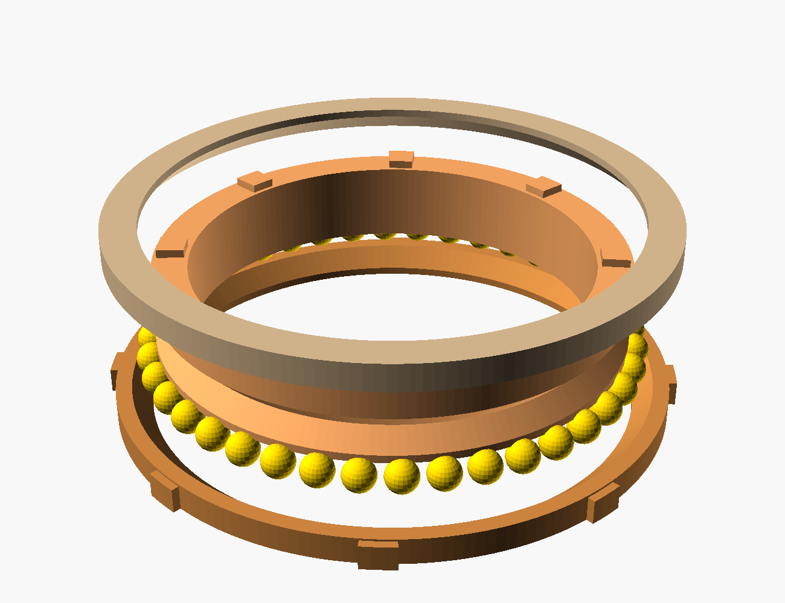
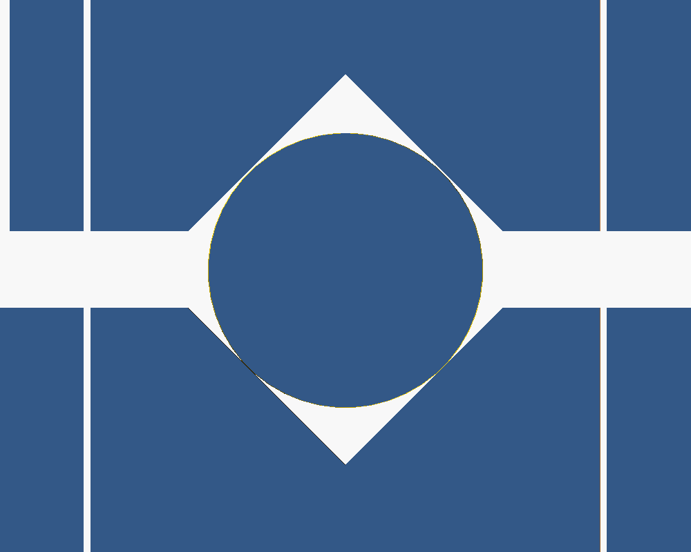

# Canhão de brinquedo v12: nenhuma peça precisa de suporte, folgas revistas, base de 15 cm, rolamento de esferas de verdade e só 2 itens para comprar

Arquivo único: [`artilharia.scad`](artilharia.scad), 100% paramétrico, ASCII puro e sem bibliotecas externas.
Os STLs prontos de todas as peças estão em [`stl/`](stl/), e tudo junto em `canhao_completo.zip`.

**Para comprar, só 2 itens:**
- **~40 BBs de airsoft de 6 mm** (compre um pacote; sobram muitas): são as esferas do rolamento da mesa.
- **1 mola de compressão 0,8 × 9 × 75 mm** (fio de 0,8 mm, Ø externo 9 mm, 75 mm de comprimento).

## Novidades da v12 (depois do primeiro teste de impressão)

No primeiro teste, os eixos não entravam nas roscas e engrenagens, o pistão e o projétil travavam,
e as peças altas viravam espaguete. Isto mudou:

- **Nenhuma peça precisa de suporte.**
  - A `culatra` agora são **2 metades deitadas**, `culatra_cima` e `culatra_baixo`, coladas depois.
  - O `cano` e o `soquete` saem deitados, com o fundo plano e chanfros de 45°.
  - Todo furo que fica deitado tem formato de **gota**, com teto a 45°, e sai redondo sem suporte.
- **Eixos 0,25 mm mais finos.**
  - No sextavado sobram 0,25 mm por lado. As pontas são chanfradas para entrar fácil, e as 2 arestas de baixo também, contra o "pé de elefante".
  - Servem nas roscas, coroas e manivelas **que você já imprimiu**: os furos dessas peças não mudaram.
- **Pistão:** 0,35 mm por lado no cilindro (era 0,25), e a quilha corre com 0,3 por lado no rasgo (era 0,2).
- **Projétil:** 0,3 mm por lado no cano (era 0,15). Quem cresceu foi a alma do cano, então os **projéteis já impressos continuam servindo**.
- **Encaixes da culatra:** a espiga do cano entra com 0,3 por lado (era 0,2), e a tampa com 0,25 (era 0,2).
- **Gatilho: dois defeitos antigos.** Nenhuma checagem antiga testava o gatilho contra a culatra.
  - O olhal do pino raspava 1 mm no cilindro. O pivô foi 2 mm para fora.
  - A janela do dente era rasa, e o dente batia na parede. A janela agora vai até dentro do furo.
  - O pé do mancal da rosca de armar também invadia a lingueta e foi refeito.
- **Pinos menores:** o dos ponteiros ficou 0,15 mais fino (0,2 por lado no furo), e o pino pivô também (0,22 por lado na mesa).

**O que reimprimir:**
- **Peças novas:** `culatra_cima` e `culatra_baixo` (substituem a `culatra`).
- **Peças alteradas:**
  - `cano`, `soquete`, `tampa` e `amortecedor`;
  - `gatilho` e `pino_gatilho`;
  - os 5 eixos (`eixo_az`, `eixo_el`, `eixo_munhao`, `eixo_pinhao` e `eixo_armar`);
  - `ponteiro_az`, `ponteiro_el` e `pino_pivo`.
- **O `pistao` não mudou.** Só reimprima **sem suporte**: com suporte, os dentes da cremalheira fecham.
- **Atalho:** o `reimprimir_v12.zip` traz só essas 17 STLs (as 16 novas ou alteradas e o `pistao`).
- **Todo o resto vale como está**: base, mesa, carro, anéis, roscas, coroas, pinhão, manivelas, volante, punhos, travas, coroa de elevação, projéteis e porta-projéteis.

## Tamanho (v11)
Tudo foi reduzido para **77%** (fator 150/194), para a **base ficar com 15 cm**.

**Medidas do canhão montado:**
| Medida | Valor |
|---|---|
| Base | **Ø15 cm** (16 cm com a manivela de azimute) |
| Altura com o cano na horizontal | ~17 cm |
| Altura com o cano a 85° | ~24 cm |
| Comprimento (cano a 0°) | ~20 cm |
| Largura | ~16 cm |
| Eixo do munhão | a 11 cm do chão |

**O que não encolheu (de propósito):**
- **Folgas:** sairiam 23% menores e os encaixes travariam. No arquivo elas usam `mm_real()` e saem com o valor real.
- **BBs de 6 mm:** são compradas. O rolamento continua para BB de 6 mm, num raio menor, e agora cabem **40 BBs**.
- **Mola:** a de 12 mm não cabe mais. A proporcional é a de **0,8 × 9 × 75 mm**, que no AliExpress aparece como "mola de compressão 0,8 x 9 x 75 mm".
  Ela comprime de 12,8 a 39,8 mm e é mais leve de armar.
- **Profundidade das gravações** (0,6 mm) e o **texto pequeno** do tambor, para continuarem legíveis.

**Continua igual:** 120:1 e 3° por volta nas duas manivelas, os mesmos cursos e todos os mecanismos.

**Como funciona no arquivo:** o `.scad` continua desenhado em escala 1:1 (base de 194 mm), e toda peça sai multiplicada por `ESCALA` na exportação.
Nas seções de projeto abaixo, algumas medidas internas ainda estão na escala de desenho. As **folgas** e as **medidas desta seção** são reais.

Todo o resto é impresso: rolamento, baionetas, pinos, eixos e travas. Não há nenhum parafuso nem rosca em plástico para espanar.

## Pontaria

| Eixo | Acionamento | Redução | 1 volta da manivela | Números do tambor | 1 marca do tambor |
|---|---|---|---|---|---|
| **Azimute** | rosca sem fim → mesa = setor de coroa (passo de 120 dentes), módulo 0,97 (Ø118) | 120 : 1 | **3°** | **1° a cada 1/3 de volta** | 0,1° |
| **Elevação** | rosca sem fim → setor de coroa (passo de 120 dentes), módulo 0,77 (Ø94) | 120 : 1 | **3°** | **1° a cada 1/3 de volta** | 0,1° |

| Eixo | Curso útil | Batente | Dentes que sobraram |
|---|---|---|---|
| **Azimute** | **−50° a +50°** (giro total de 100°) | os ressaltos das pontas da faixa da mesa batem no pilar do ponteiro a ±52° | arco de 120° (41 dentes) |
| **Elevação** | **−20° a +85°** (dá para atirar para baixo) | ressaltos da coroa batem no carro a −22° e +87° | arco de 220° em volta do eixo |

**Por que a coroa não "solta" no fim do curso:** o batente fica **antes** do último dente. No azimute, o setor
tem dentes até ±60°, mas o batente para a mesa em ±52°. No fim do curso, a rosca ainda está engrenada com
**8° de dentes de sobra** (cerca de 2,7 dentes) de cada lado. Na elevação, o batente para em −22°/+87°, e a
rosca continua no meio dos dentes. Se você forçar a manivela no batente, ela só para, porque a rosca não
consegue pular para fora da coroa.

**Leitura em duas etapas, como num micrômetro:**
1. **Escala grande:** número a cada 10°, traço a cada 5°, ponto a cada 2,5°. No azimute, a escala de −50 a +50
   fica **gravada na mesa** (na faixa de trás) e gira com ela. O **ponteiro é fixo na base**, num pilar atrás.
   Na elevação, a escala continua na coroa.
2. **Tambor da manivela** (Ø34): o número 0 fica no braço, e os números 1 e 2 a cada 1/3 de volta (cada um vale 1°).
   Os traços médios marcam 0,5° e os curtos 0,1° (30 marcas por volta). Está gravado **"1 VOLTA = 3°"**. A seta do mancal externo é o índice.

Exemplo: o ponteiro está entre o ponto de 32,5° e o traço de 35°, e o tambor mostra "1" mais 3 traços curtos.
A leitura é 32,5° + 1,3° = **33,8°**. Uma volta inteira da manivela soma 3°. Para ir de 0° a 45° são 15 voltas.

**Travas dos eixos:** são travas em "E" impressas (`trava_6` e `trava_8`). Você encosta a boca da trava no
canal do eixo e empurra de lado. Ela abre um pouco, estala no canal e não sai mais sozinha. Para tirar,
empurre pela aba. Cada eixo tem 2 ou 3 canais, e o punho da manivela também tem a sua trava.
Na v11 a trava tem **1,0 mm** de espessura (5 camadas de 0,2), num canal de 1,24 mm. Imprima com camada de 0,2 mm para ela sair exata.

**Manivelas:** cada uma tem 3 mancais (o externo afasta a manivela de tudo), um tambor graduado e um **punho em capa**.
A capa é fechada em cima e encaixa no pino com um **clique**: a ponta do pino é bipartida e tem um dente cônico,
que entra num canal interno da capa. Depois disso ela **não sai mais**, mas **gira solta**, porque o dente fica folgado no canal.

## Lançador de mola

*Corte armado: o pistão (laranja) está recuado e a mola (azul) comprimida. O projétil está carregado e a parte lisa do pinhão encara a cremalheira.*

**Mola (AliExpress):** mola de compressão de aço, **fio 0,8 mm × Ø externo 9 mm × 75 mm**.
Procure por "compression spring 0.8 x 9 x 75". Se só achar mais longa, corte. A mola trabalha dentro do pistão,
apoiada numa guia na tampa, com pré-carga de ~13 mm e ~40 mm comprimida quando armada (~6 N em repouso, ~20 N armada, estimando ~0,5 N/mm).
A v10 chegava a ~27 N num pinhão maior: agora o torque de armar caiu para pouco mais da metade (~0,19 N·m no pinhão, contra 0,33).

**Projétil:** a granada impressa de **Ø9,6 mm** (veja abaixo). Ela é carregada **pela boca do cano**, como num
canhão antigo, e desliza até o pistão. Com o cano na horizontal, empurre com o `soquete`.

### Como funciona

1. **Armar:** o **volante de armar** (Ø22, com uma capa de clique que gira solta, igual à das manivelas) fica atrás, na esquerda, com o eixo paralelo ao cano.
   Ele gira uma **rosca sem fim
   (16:1, autotravante)**, que gira uma coroa e um **pinhão "mutilado"**. Esse pinhão tem 8 dentes de um lado e é liso do outro,
   como o setor de um gearbox de airsoft. O pinhão puxa a **cremalheira** que fica no topo do pistão, comprimindo a mola.
2. **Clique:** quando o pistão chega a 27 mm de recuo, a **lingueta do gatilho** estala na frente dele.
3. **PRONTO:** continue girando cerca de **2 a 5 voltas**, até a faixa gravada na coroa de armar passar sob a seta.
   Nessa faixa a parte lisa do pinhão encara a cremalheira e o caminho fica livre. São 16 voltas por disparo no total.
4. **Disparar:** aperte o **botão do gatilho** (na esquerda, atrás) para dentro. O dente sai, a mola empurra o pistão
   e o pistão empurra o projétil.

> Não gire além da faixa PRONTO. Se girar demais, o pinhão volta a pegar a cremalheira e trava contra a tampa.
> Basta voltar uma volta.

### Por que a pontaria não sai do lugar ao armar e disparar

- **A força da mola fecha dentro da culatra:** a mola fica entre o pistão e a tampa, na mesma peça.
  Ela não empurra nem o carro nem a mesa.
- **As roscas de pontaria são autotravantes.** O avanço é de 4–5°, e tan γ < μ. Nenhum esforço que chega às coroas consegue girar
  as roscas de volta. Só a sua mão, pela manivela, move a pontaria.
- **O volante de armar tem o eixo paralelo ao cano.** O torque da sua mão gira o cano em torno do próprio eixo,
  e não em elevação.
- **A rosca de armar também é autotravante.** Soltar a manivela no meio do caminho não dispara nem volta.

### Cortes

| Repouso | Armado |
|---|---|
|  |  |

## Projéteis

Formato de granada de morteiro: **corpo cilíndrico curto + ogiva tangente curta** (Ø9,6 × 17 mm), com a ponta
levemente achatada e base plana chanfrada. A base é onde o pistão empurra, e o chanfro ajuda a entrar no funil do cano.

- **Desliza sem vibrar:** tem **duas cintas de guia**, na frente e atrás, com 0,3 mm de folga por lado na alma de 10,2 mm.
  O meio é rebaixado 0,4 mm, então só as cintas tocam o cano. Com pouco atrito e dois apoios afastados, ele não
  "dança" no tubo e sai alinhado.
- **Caminho conferido no CGAL:** o projétil passa livre apoiado no pistão armado, sem tocar no dente do gatilho,
  depois pelo degrau, pelo funil e por todo o cano.
- **Cartucheiras na base:** a própria base guarda **10 projéteis** numa **saia baixa** (16 mm) rente ao anel.
  Eles ficam deitados a 25° e apontando para fora, espalhados por toda a lateral: 5 do lado +Y (de 40° a 140°)
  e 5 do lado −Y (de 200° a 300°, livre da manivela de azimute).
  Cada um entra 13 mm. **A ogiva fica inteira para fora**, e você pega de lado com dois dedos.
  O espaçamento é o mesmo nos dois lados: **25° entre projéteis**.
  Como estão inclinados para cima, a gravidade os mantém no lugar. A saia fica abaixo da mesa giratória.
- **Porta-munição avulso:** a peça `porta_projeteis`, bandeja com 6, continua disponível se você quiser guardar mais.
- **Em 4 partes, de 2 cores (v8):** de baixo para cima, as partes alternam as cores:

  | Parte | Cor | Altura |
  |---|---|---|
  | `projetil_corpo` | cor principal | corpo inteiro (10 mm) |
  | `projetil_anel` | cor 2 | 1,5 mm, uma faixa na base da ogiva |
  | `projetil_meio` | cor principal | 2,7 mm, o meio da ogiva |
  | `projetil_ponta` | cor 2 | ~2,4 mm, a ponta |

  - **Encaixes de centragem para colar:** o **pino de Ø3,9** do corpo atravessa o anel e entra no meio.
    O meio tem um **pino de Ø2,3** que entra na ponta.
  - **Folga para a cola:** 0,35 mm no diâmetro, então as partes entram sem forçar e não tem como montar torto.
  - **Cola:** cianoacrilato (Super Bonder) funciona bem em PETG; lixe de leve as faces antes.
    Passe pouca cola, só no pino, para não escorrer na cinta de guia.
  - **Impressão:** cada parte imprime com a face plana para baixo e sem suporte. Os furos ficam embaixo, como pontes de 3 a 5 mm.
  - 
  - **Nada muda por fora:** o projétil inteiro tem as mesmas medidas, então desliza no cano e entra nos casulos como antes.

| Impressão do projétil | Peso | Saída (ideal) | Energia |
|---|---|---|---|
| 2 paredes, 15% | 0,65 g | ~13,6 m/s | 0,06 J |
| **3 paredes, 20% (recomendado)** | **0,9 g** | **~13,2 m/s** | **0,08 J** |
| maciço | 1,25 g | ~12,7 m/s | 0,10 J |

Na v11 a mola guarda ~0,36 J armada (a da v10 guardava ~0,65 J). O pistão caiu de 7 para 3,2 g e o projétil
também ficou mais leve, então a **velocidade de saída até subiu um pouco**. A energia de cada tiro é menor (0,08 J contra 0,12 J), e o alcance fica parecido.

**Por que a velocidade quase não muda:** o pistão (~3,2 g) leva quase toda a massa em movimento. Um projétil
mais pesado sai só um pouco mais devagar, mas com **mais energia**, e sofre menos com o ar. Com atrito, os valores reais
ficam uns 20–30% abaixo. Os projéteis imprimem em pé, com a ponta para cima e sem suporte.
Para lixar as cintas, se ficarem justas, gire o projétil entre os dedos com uma lixa 400.

## Imprimindo em PETG: folgas, encaixes e pontos críticos

### Folgas (parâmetros no topo do `.scad`)

| Parâmetro | Valor | Onde | Se travar |
|---|---|---|---|
| `folga` | 0,25 mm | furo sextavado das peças (rosca, coroa, cubos) | 0,30 |
| `folga_eixo` | **0,25 mm** (v12) | o **eixo** sai mais fino: com `folga`, dá 0,25 por lado no sextavado | 0,30 |
| `folga_gira` | 0,40 mm (Ø) | eixo sextavado girando em furo redondo (mancais, bochechas). Com o eixo mais fino, sobra ~0,35 por lado | 0,50 |
| `folga_desl` | **0,35 mm por lado** (v12) | pistão no cilindro. A quilha tem 0,3 por lado no rasgo | 0,45 |
| `folga_proj` | **0,6 mm (Ø)** (v12) | projétil na alma do cano: 0,3 por lado | 0,8 |
| `folga_ax` | 0,15 mm | **rosca encostada nos mancais** (sem jogo axial) | 0,25 |
| `folga_dente` | **0,20 mm** (v8; era 0,12) | entre os dentes (backlash). Cobre o "pé de elefante" e a dilatação do PETG | 0,25 |
| `folga_cola_c` | 0,2 mm por lado | encaixe colado do carro na mesa (espaço para a cola) | — |
| `folga_cola` | 0,35 mm (Ø) | pinos de centragem do projétil | — |

Teste antes de imprimir tudo: imprima `trava_6`, `eixo_el`, `rosca_el` e `manivela_el`.
Na v12 o eixo tem que **entrar com a mão**, sem martelo nem lixa. Se ainda ficar duro, suba `folga_eixo` para 0,30.
Se o eixo entrar sem forçar e a trava estalar, as folgas estão boas para a sua impressora.

**Revisão geral das folgas (v8).** Furo impresso em FDM costuma sair 0,1 a 0,2 mm menor e pino um pouco maior.
Por isso conferi todos os encaixes e abri os que estavam no limite:

| Encaixe | Antes | Agora | Por quê |
|---|---|---|---|
| Espiga do cano no soquete da culatra | 0,12 por lado | **0,2 por lado** | 0,12 por lado virava interferência |
| Ressaltos da baioneta do cano | 0,05 mm de aperto | **justo, sem aperto** | o aperto somado ao degrau das camadas podia travar o giro |
| Espigão da tampa no cilindro | 0,12 por lado | **0,2 por lado** | a tampa precisa girar 30° com a mola empurrando |
| Pino do gatilho na orelha da culatra | 0,12 por lado | **0,17 por lado** | entrava forçado |
| Dentes de todas as engrenagens | 0,12 | **0,20** | as primeiras camadas alargam o dente |

Ficaram como estavam, porque já têm folga boa:
- o pistão no cilindro (0,25 por lado);
- a quilha no rasgo (0,2);
- o eixo sextavado girando nos mancais (0,2 por lado);
- os anéis do rolamento nas sedes (0,15) e as BBs no canal (~0,1 de jogo);
- as capas dos punhos no pino (0,25);
- os projéteis no cano (0,15) e nos casulos (0,25);
- o pino pivô: Ø6,2, justo na mesa (0,15 por lado) para servir de guia e solto na base (0,4 por lado).

Ative a **compensação de "pé de elefante"** no fatiador (Creality Print: ~0,15 mm). Ela importa principalmente nas engrenagens e nos furos que ficam na primeira camada.

### O que foi reforçado nesta revisão

| Ponto | Problema | Solução |
|---|---|---|
| **Roscas sem fim** | ficavam com 1 mm de jogo de cada lado e podiam escorregar no eixo. Cada 1 mm de deslize gira a coroa sem mexer na manivela: **~0,85° no azimute** | a rosca agora encosta nos mancais (0,15 mm), que funcionam como **mancal de empuxo** |
| **Batente do pistão** | o pistão (~7 g a ~13 m/s na v10; 3,2 g na v11) para em menos de 1 mm, gerando **centenas de N** de pico a cada tiro. O tampão do cano preso por 1 M3 numa parede de 2,5 mm ia rachar | o batente agora é um **degrau interno da culatra**, com o **anel `amortecedor`** (TPU de preferência; em PETG serve de espaçador). O cano não leva mais a pancada |
| **Tampa traseira** | era fixa, e o pistão entrava pela frente | **tampa removível com baioneta em J** (2 ressaltos de 3 mm; ~3,6 MPa com a mola; ~4,5 MPa na v11). O pistão entra por trás |
| **Pino do punho** | Ø6 impresso em pé: a mão força o pino entre as camadas (~19 MPa) e ele quebra na raiz | **Ø8** (~8 MPa; na v11 sai com Ø6,2 e ~13 MPa, porque a mão não encolheu); a fenda do clique fica só na ponta, onde o esforço é pequeno |
| **Elevação sem fim de curso** | insistir na manivela gera até ~4 N·m na coroa e pode esmagar a culatra ou cisalhar dentes | **batentes em −22° e 87°**: 2 ressaltos na face interna da coroa batem num bloco da bochecha |
| **Gatilho** | 4 mm de espessura sob carga constante (~22 MPa com a mola armada): o PETG flui e a lingueta entortaria com o tempo | **6 mm** e dente de 5 mm (~10 MPa; ~12 MPa na v11: a mola tem 74% da força numa peça 23% menor). Gira num **pino impresso de Ø4** com `trava_4`, e a mola de lâmina ficou mais longa (deforma <1%, não perde a força) |
| **Cubos e eixos** | os canais das travas reduzem o sextavado para Ø4,6 | torção ~15 MPa com a mão forçando: aceitável. **Na v11, ~25 MPa:** o eixo sai com 4,6 mm (3,6 mm no canal) e a mão força igual. Imprima os eixos com 100% e não force a manivela no batente |

### Pontos que continuam merecendo atenção

- **Rosca de armar** (impressa em pé): o filete trabalha **entre camadas**. Use 4+ paredes, 100% de preenchimento,
  240–250 °C e ventoinha em 30–50% para a camada colar bem.
- **Dentes da coroa de elevação (módulo 0,77 na v11):** aguentam ~95 N (eram ~160 N com módulo 1). Os batentes limitam o esforço, mas **não force a manivela quando ela parar**.
- **Lingueta do gatilho com o canhão armado por muito tempo:** o PETG flui sob carga constante. Não deixe armado por dias. Arme, atire e desarme.
- **Culatra (v12):** as 2 metades saem com a face do corte na mesa e **sem suporte**. A `culatra_baixo` imprime de cabeça para baixo e a `culatra_cima` em pé. Use 4 paredes.
- **PETG em PEI liso** pode arrancar o revestimento da placa. Use cola bastão ou PEI texturizado.
- **Na v11, os pontos mais fracos são os eixos e o pino do punho.** Peças menores com a mesma mão forçando: quando a manivela parar no batente, pare.
- Os outros pontos (rolamento, mesa e eixos sob carga de pontaria) trabalham com tensões baixas, abaixo de 5 MPa.

### Dica de artilheiro (para eliminar a folga dos dentes)

Toda engrenagem tem folga. Para a leitura ser repetível, **sempre chegue no ângulo girando no mesmo sentido**.
Por exemplo, sempre subindo. Se passou, volte meia volta e chegue de novo pelo mesmo lado. É assim que se aponta
artilharia de verdade. Na elevação, o próprio peso do cano já encosta os dentes sempre do mesmo lado.

## Peso em PETG (1,27 g/cm³)

"Típico" significa 3 paredes de 0,4 mm, topo e fundo de 1,2 mm e 20% de preenchimento giroide.
A estimativa usa volume e área de cada STL (±15%).

| Peça | Maciço | Típico |
|---|---|---|
| base (bandeja com janelas, sede do rolamento, 10 casulos, plataforma vazada, pilar) | 93 g | **~86 g** |
| mesa (assento do carro, aro dentado, copo, raios, faixa da escala) | 53 g | **~48 g** |
| carro (disco central, bochechas em treliça, mancais) | 43 g | **~37 g** |
| rolamento: 3 anéis (sempre com 100%) | 47 g | **47 g** |
| setor de elevação raiado (−20° a +85°) | 20 g | ~19 g |
| culatra (2 metades) + cano | 35 g | ~32 g |
| 10 projéteis (40 partes) | 12 g | ~11 g |
| todo o resto (roscas, manivelas, volante, capas, eixos, travas…) | 56 g | ~51 g |
| **Total impresso** | **~359 g** | **~331 g** |
| + 40 BBs e mola | | ~8 g |

**v11 contra a v10: de ~591 g para ~333 g no típico (−44%).**
- **O maciço caiu para 48%.** Reduzir tudo a 77% divide o volume por 0,773³ = 2,2.
  Só o rolamento cai menos, porque o perfil dele (BB de 6 mm, paredes e folgas) ficou em tamanho real.
- **O típico cai menos:** as paredes continuam com 1,2 mm, e nas peças menores elas já são quase a peça inteira.
  Por isso, nesta escala, o típico fica perto do maciço.
- **Tempo e filamento:** espere cerca de metade do tempo de impressão da v10.

**Por que o "típico" cai menos que o "maciço":** na impressão FDM, o miolo já é preenchimento ralo, e quem
pesa são as paredes. Tirar volume ajuda muito no maciço. No típico, o que mais pesa é a área de superfície.
- **Para pesar menos:** imprima a base com **2 paredes e 10–15%**. Ela quase não leva esforço.
- **Mantenha 4 paredes e 100%** nas peças que trabalham: roscas, pinhão, gatilho, travas e punhos.

### Base em bandeja (v6, enxugada na v7)
- **Mais baixa:** a mesa agora fica a 20 mm da mesa da sala (antes eram ~35 mm). O punho da manivela de azimute fica ~4 mm acima do chão.
  Centro de gravidade mais baixo = canhão mais estável.
- **Bandeja:** o setor de dentes da mesa corre **dentro** da base, cercado por uma **parede**
  (2 mm de folga radial). A parede protege os dentes, endurece a base como a borda de uma assadeira, e é nela que ficam os batentes.
- **Rígida sem ser maciça:** o anel da pista (paredes de 2 mm e teto em V) se liga ao cubo central por 4 raios e à parede por 6 nervuras.
  O piso de 3 mm virou só uma moldura: entre as nervuras ele tem **janelas**, porque quem amarra a parede são as nervuras.
- **Casulos de projétil (v7):** a saia contínua saiu. Cada projétil tem o seu casulo, um bloco preso na parede com
  1,8 mm de plástico em volta do furo. **Entre um casulo e outro não há nada**, e por baixo fica tudo aberto.
- **Pilar do ponteiro (v9):** atrás, colado na parede. Leva a agulha da escala de azimute e é o batente.
- **Sem anel por cima:** a mesa continua só apoiada nas BBs. O peso do cano e do carro a mantém no lugar, e os blocos de batente seguram o giro.
- **Plataforma da manivela (v7):** agora é vazada. Os **3 mancais descem até o chão** como paredes, os dois de dentro entram na parede
  da bandeja e **2 trilhos** de 3 × 11 mm amarram os três por baixo da rosca, a 2,75 mm dela. A rosca entra na bandeja por uma janela da parede.

### Mesa e carro: carro colado no centro da mesa (v9)
A mesa giratória (a coroa de azimute) e o carro (bochechas e mancais da elevação) são **duas peças**.
O carro senta **no centro da mesa** e é **colado** ali.

**O encaixe (só para posicionar; quem prende é a cola):**
- **Assento:** o centro da mesa tem um **assento** de Ø37, com a espessura cheia da mesa.
- **Espiga:** em cima do assento há uma **espiga retangular** de 23 × 15,5 × 3 mm e um **pino de posição** de Ø3,9, fora do centro.
- **Rebaixo:** o carro tem embaixo um **disco** de Ø37 × 6 mm com o rebaixo dessas duas formas, **0,2 mm de folga por lado** para a cola.
  Por causa do pino fora do centro, o carro só entra **virado para a frente** (cano para o lado dos dentes).
- **Ranhuras:** o fundo do disco tem **2 ranhuras de cola** em anel. O excesso de cola escorre para elas, em vez de levantar o carro.
- **Área colada:** ~2000 mm², somando o anel do assento e as paredes e o topo da espiga.

**Cola recomendada:** **epóxi** de 5 ou 10 minutos (Araldite). É o melhor para PETG e preenche bem a folga de 0,2 mm.
Cianoacrilato (Super Bonder) também cola, mas fica quebradiço com as pancadas dos disparos.
- **Preparo:** lixe as faces com lixa 220 e limpe com álcool.
- **Colagem:** passe a cola, encaixe, aperte com a mão e deixe curar com o canhão em pé.
- **Antes de colar:** coloque o `pino_pivo` na mesa. A cabeça dele fica num rebaixo no topo da espiga e some debaixo do carro.

**Mesa:**
- **Grosso (12 mm):**
  - o **assento do carro**, com 6 bolsões por baixo para aliviar (teto de 3 mm);
  - o **aro dentado**, 6 mm abaixo do pé do dente;
  - a **faixa da escala** atrás.
- **Fino:**
  - o **copo** que abraça o topo do anel interno do rolamento (9,2 mm);
  - **6 raios** de 9 × 7 mm. Engrossaram em relação à v8, porque agora levam o peso do carro do centro até o anel das esferas.
- **Faixa da escala (contrapeso):** um arco de **110°** atrás, do lado oposto aos dentes.
  - Tem os **graus gravados no topo** e 10 bolsões por baixo, com teto de 2,4 mm.
  - Faz de **contrapeso** do aro dentado.
  - Nas duas pontas tem os **ressaltos de batente**.

**Base:**
- **Pilar do ponteiro:** atrás (no ângulo 180) há um pilar colado na parede da bandeja, com a **agulha** que aponta para a escala da mesa, 0,5 mm acima dela.
- **Batente:** o pilar é também o **batente de azimute**. Em ±52°, o ressalto da ponta da faixa encosta nele, e a rosca ainda tem dentes de sobra.
- **O que saiu:** a aba da escala e os 2 blocos de batente antigos.

**Carro:**
- **Quadro:** só o disco central, 2 trilhos curtos sob as bochechas e os pés e o trilho dos mancais.
  Saíram os garfos, as travessas e os trilhos compridos.
- **Bochechas:** em treliça, como na v7.1.

**Impressão:**
- **Mesa:** fundo para baixo. A espiga e o pino de posição ficam em cima.
- **Carro:** disco para baixo e bochechas para cima. O rebaixo fica embaixo, como uma ponte de 20 mm.

### Coroa de elevação raiada (v7)
O aro dentado e o cubo continuam com 10 mm. Entre eles há **7 raios** largos (8 a 10 mm) e **finos na espessura: 4 mm** (v7.1),
rentes à face da escala, com cantos arredondados onde encontram o aro e o cubo:
- **2 nas bordas** do setor;
- **1 embaixo de cada ressalto de batente**, que leva a pancada se você forçar a manivela no fim do curso;
- **3 intermediários**.

O resto é janela. Só onde ficam os números da escala sobra uma **faixa fina de 2,4 mm**, rente à face de fora,
que imprime direto na mesa da impressora e mantém a gravação legível.
Os **ressaltos de batente** ficam sobre pastilhas com os 10 mm cheios, porque é por eles que passa a pancada do fim de curso.

### Capa de clique no volante de armar (v7.1)
É a mesma ideia da capa das manivelas, em tamanho menor:
- **Pino:** de Ø3,9, bipartido, com dente cônico.
- **Capa:** de Ø7,7 × 10,7 mm, com um canal interno.

Você empurra a capa, o dente estala no canal e ela **não sai mais, mas gira solta**, com 0,25 mm de folga.
A capa assenta num ressalto de 2 mm, acima do cubo do volante, e não passa da borda dele (Ø22).
Peça: `punho_armar` (imprima em pé, com a tampa para cima).

## Sem nada comprado além das BBs e da mola

### Rolamento de esferas impresso (contato em 4 pontos)
É um **rolamento de verdade**: um **anel menor dentro de um anel maior**, com as BBs **presas** no canal entre os dois.
É o mesmo tipo de rolamento das mesas giratórias de guindastes e de torres: segura o peso, o esforço de lado e a alavanca do cano.

Vista explodida: os 3 anéis são **inteiros (360°)**. De cima para baixo:
- a metade de cima do anel externo;
- o anel interno, com os dentes que entram na mesa;
- as 40 BBs;
- a metade de baixo do anel externo, com as chavetas que entram na base.

As duas metades se empilham e formam o anel externo; cada uma tem metade do canal em V.

**Corte (da esquerda para a direita):**
- **Anel interno:** sobe e entra na mesa.
- **BB:** no canal entre os anéis.
- **Anel externo:** assentado na sede da base.

**As peças:**
| Peça | Onde fica | Encaixe |
|---|---|---|
| `anel_interno` (Ø73 a Ø87) | preso **na mesa, por cima** | 8 dentes para cima, que entram em rasgos largos da mesa |
| `anel_externo_baixo` (Ø90 a Ø103) | preso **na base, por baixo** | 8 chavetas na lateral, que descem nos rasgos da parede da sede |
| `anel_externo_cima` | colado em cima do `anel_externo_baixo` | a parede da sede da base centraliza as duas metades |

**Como as BBs ficam presas:**
- Cada anel tem um **canal em V de 90°** virado para o outro: o interno por fora, o externo por dentro.
  A BB encosta nos **4 flancos**, 2 de cada anel, a 45°. É isso que segura o peso, o esforço de lado e a alavanca.
- **Entre os dois anéis sobra um vão de só 1,6 mm.** A BB de 5,95 mm não passa por ele.
  Por isso ela não sai nem para cima nem para baixo, e os anéis não se separam.
- **Folga:** o canal foi desenhado para uma esfera de 6,15 mm. Com BB de 5,95 sobra ~0,1 mm de jogo, e a BB roda solta, sem prender.
- **Por que o anel externo tem 2 metades:** é o único jeito de pôr as BBs dentro de um rolamento com o anel interno já no lugar.
  A divisão fica bem no meio do canal. Você põe as BBs com a metade de cima fora e depois fecha.
- **Vão entre a coroa e a base: 1 mm.** O topo do anel externo fica rente ao topo da base, 1 mm abaixo da mesa.
  O peso da mesa e do canhão passa **todo pelo rolamento**: mesa → anel interno → BBs → anel externo → base.
- **40 BBs:** sobra ~0,9 mm entre elas, e elas rolam sem raspar uma na outra.
- **Impressão:**
  - todos os flancos do V ficam a 45°, então nenhum anel precisa de suporte;
  - cada anel já sai na posição certa no arquivo;
  - imprima com **4 paredes e 100%**.

### Sem parafusos
| Onde era parafuso | Agora | Por que não espana |
|---|---|---|
| Carro → mesa (4) | **colado no centro** (v9): espiga e pino de posição, com epóxi | a cola trabalha numa área grande (~2000 mm²), sem rosca nenhuma |
| Tampa traseira (2) | **baioneta em J**: encaixe, empurre, gire 30° e solte. A mola puxa os ressaltos para o entalhe | é a própria mola que trava a tampa |
| Cano (1) | **baioneta**: encaixe até o colar e gire 30°. Fica justo no fim do curso | o cano quase não leva esforço: a pancada fica no degrau da culatra |
| Pivô do gatilho (1) | **`pino_gatilho`** de Ø3,1 com **`trava_4`** | o pino só leva cisalhamento (~27 N) |

## Peças (troque `PARTE` no Customizer)

Cada peça já sai na orientação de impressão.

| Grupo | Peças |
|---|---|
| Base e mesa | `base`, `mesa`, `anel_interno`, `anel_externo_baixo`, `anel_externo_cima`, `pino_pivo` |
| Carro | `carro`, `roda_el`, `ponteiro_el`, `ponteiro_az` (encaixa no pilar da base) |
| Pontaria | `rosca_az`, `rosca_el`, `manivela_az`, `manivela_el`, `eixo_az`, `eixo_el`, `eixo_munhao` |
| Lançador | `culatra_cima` e `culatra_baixo` (deitadas, sem suporte; coladas com 2 pinos de filamento), `tampa`, `amortecedor` (TPU), `pistao`, `cano`, `pinhao_armar`, `coroa_armar`, `rosca_armar`, `volante_armar`, `eixo_pinhao`, `eixo_armar`, `gatilho`, `pino_gatilho`, `soquete`, `porta_projeteis` |
| Projéteis (×10) | `projetil_corpo` e `projetil_meio` na cor principal; `projetil_anel` e `projetil_ponta` na cor 2 (o `projetil` inteiro continua disponível, numa cor só) |
| Pequenas | `punho` ×2 e `punho_armar` ×1 (capas de encaixe), `trava_4` ×1, `trava_6` ×11, `trava_8` ×2 (imprima algumas a mais de cada) |

**Comprar:** ~40 BBs de 6 mm e 1 mola 0,8 × 9 × 75 mm. Mais nada (os pinos da culatra são 2 pedaços do seu próprio filamento de 1,75 mm).

**Imprima os 3 anéis do rolamento com 4 paredes e 100%.**

## Montagem passo a passo

**Material:**
- ~40 BBs de 6 mm e a mola;
- **epóxi** de 5 ou 10 min (para o carro);
- **cola instantânea** (para o anel de cima e os projéteis);
- vaselina ou graxa de silicone;
- lixa 220 e 400, estilete, alicate de bico e uma chave de fenda pequena.

**Regra de ouro:** monte tudo **a seco** antes de colar qualquer coisa. Se um eixo ou encaixe estiver duro, lixe o furo
(lixa enrolada num palito) ou passe uma broca do tamanho com a mão. **Não force**: PETG trinca quando forçado.

**Lados:** "direita" e "esquerda" são **olhando o canhão de frente** (pela boca do cano).
- **Direita:** a bochecha com o braço do ponteiro de elevação e a coroa de elevação.
- **Esquerda:** o gatilho, a coroa de armar e o volante.

### 0. Teste de folgas (antes de imprimir o resto)
Imprima primeiro a placa das peças pequenas. Passe o `eixo_el` na `rosca_el` e estale uma `trava_6` num canal do eixo.
Se a rosca entrar sem forçar e a trava estalar e ficar firme, as folgas estão certas para a sua impressora.

### 1. Rolamento (monte na bancada, numa mesa lisa)
O fundo do `anel_interno` e o fundo do `anel_externo_baixo` ficam no **mesmo plano**. Em cima de uma mesa lisa,
os dois já ficam na altura certa para as BBs entrarem.
1. **Anéis na mesa:** ponha o `anel_externo_baixo` deitado na mesa e o `anel_interno` dentro dele, com os dentes para cima.
2. **Vaselina:** passe uma camada fina nos dois canais. Ela segura as BBs enquanto você monta e deixa o giro macio.
3. **BBs:** distribua as **40 BBs** no canal entre os dois anéis. Elas assentam sozinhas nos flancos de baixo.
   Espalhe por igual, deixando o mesmo espacinho entre todas.
4. **Metade de cima:**
   - passe **3 ou 4 gotinhas de cola instantânea** na face de cima do `anel_externo_baixo`, só na borda de fora, longe do canal;
   - encaixe o `anel_externo_cima` por cima, com o flanco para baixo, alinhando as bordas de fora;
   - aperte com os dedos por alguns segundos.
5. **Confira:** gire o anel interno com a mão. Tem que girar liso, sem prender, e **não pode sair** quando você puxa.
   O rolamento agora é uma peça só, com as BBs presas dentro.
6. **Na base:** desça o rolamento na sede da base, com as 8 chavetas de fora entrando nos rasgos da parede.
   O anel interno fica pendurado nas BBs, 1 mm acima dos raios da base.

### 2. Mesa e carro (colados)
1. **Pino pivô:** ponha o `pino_pivo` no furo central da mesa, de cima para baixo. A cabeça entra no rebaixo da espiga.
2. **Teste a seco:** encaixe o carro no assento da mesa. Só entra de um jeito, com o cano para o lado dos dentes.
3. **Colagem:**
   - lixe as faces (assento, espiga e o fundo do disco do carro) e limpe com álcool;
   - passe **epóxi** no assento e na espiga, encaixe o carro e aperte;
   - limpe o excesso e deixe curar o tempo da embalagem, com a mesa deitada.

### 3. Descida da mesa (antes da rosca de azimute)
A rosca de azimute entra **depois** da mesa. Assim a mesa ainda gira solta na hora de descer.
1. **Alinhe os dentes:** gire o anel interno até o **pilar da base ficar bem no meio entre dois dentes** dele.
2. **Posição:**
   - o **ponteiro ainda fora**, senão a faixa da escala bate nele;
   - a mesa com a **faixa da escala para trás** e o **pilar entre os dois ressaltos** das pontas da faixa;
   - os dentes da coroa na frente.
3. **Desça devagar.** O pino pivô entra no furo do centro da base, e os dentes do anel interno entram nos rasgos da mesa.
   Os rasgos são largos, então não precisa acertar exato. Se a mesa não assentar, gire-a uns poucos graus para um lado e para o outro.
   Ela pousa no anel interno e fica **1 mm acima da base**, sem encostar.
4. **Ponteiro:** encaixe o `ponteiro_az` no furo quadrado do topo do pilar, com a agulha virada para a escala.
5. **Rosca de azimute:**
   - deite a `rosca_az` na calha, entre os dois mancais de dentro, girando a mesa de leve até os dentes da coroa entrarem no filete;
   - passe o `eixo_az` pelo lado da manivela, atravessando o mancal externo, o mancal de dentro, a rosca e o outro mancal;
   - encaixe uma `trava_6` no canal da ponta e outra logo depois do mancal externo (encoste a boca da trava no canal e empurre de lado até estalar);
   - ponha a `manivela_az`, a 3ª trava e estale o `punho`.
6. **Confira:**
   - gire a manivela de ponta a ponta: tem que ir de −50° a +50° liso e parar firme em ±52°, no pilar;
   - **a mesa não pode raspar na base em nenhum ponto.**

### 4. Elevação
1. **Rosca:** coloque a `rosca_el` entre os dois mancais de dentro do carro.
2. **Eixo:** passe o `eixo_el` por trás, atravessando o mancal externo, o mancal de trás, a rosca e o mancal da frente.
3. **Travas:** ponha uma `trava_6` na ponta da frente e outra depois do mancal externo.
4. **Manivela:** coloque a `manivela_el` no eixo, a 3ª trava e estale o `punho`.

### 5. Lançador (monte fora do canhão)
0. **Culatra, colando as 2 metades (v12):**
   - **Pinos:** corte 2 pedaços de **6 mm** do seu filamento de 1,75 mm. São os pinos de alinhamento.
   - **Teste a seco:** ponha os pinos nos 2 furos dos ressaltos do lado direito da `culatra_baixo` e encaixe a `culatra_cima` por cima.
     As faces do corte encostam inteiras e as bordas ficam alinhadas.
   - **Preparo:** lixe de leve as 2 faces planas e limpe com álcool.
   - **Cola:** passe uma camada fina de **epóxi** (ou Super Bonder em gel) nas faces, deixando 2 mm de distância das bordas do furo do cilindro e do rasgo de cima.
     Assim a cola não escorre para dentro.
   - **Cura:** feche, aperte com prendedores ou elásticos e deixe curar.
     Depois, raspe qualquer gota que tenha entrado no furo e confira se o pistão corre livre, sem a mola.
1. **Amortecedor:** empurre o `amortecedor` pela boca de trás da culatra até o fundo do cilindro, encostado no degrau da frente.
2. **Cano:** encaixe o `cano` no soquete da frente, alinhando os ressaltos com as entradas laterais.
   Empurre até o colar e gire 30°.
3. **Pistão e mola:** coloque o `pistao` **por trás**, com a quilha (a cremalheira) no rasgo de cima, e a mola dentro dele.
4. **Tampa:** encaixe os ressaltos da `tampa` nas entradas, empurre (comprimindo a mola), gire 30° e solte.
   A mola puxa a tampa para o entalhe e ela trava.
5. **Pinhão e coroa:**
   - com o **pistão todo para a frente**, ponha o `pinhao_armar` entre as duas placas, com a **parte lisa virada para a cremalheira**;
   - passe o `eixo_pinhao` e ponha a `coroa_armar` do lado de fora da placa esquerda. Escolha a posição no sextavado em que a **faixa PRONTO gravada fica bem embaixo da seta** do mancal;
   - prenda com as 2 travas.
6. **Rosca de armar e volante:**
   - ponha a `rosca_armar` entre os dois mancais de trás, passe o `eixo_armar` e encaixe as travas;
   - coloque o `volante_armar` atrás, com a última trava, e estale a `punho_armar` no pino.
7. **Gatilho:**
   - encaixe o `gatilho` por baixo da orelha, com o dente entrando na janela do cilindro;
   - passe o `pino_gatilho` de cima para baixo e prenda com a `trava_4` por baixo;
   - a lâmina de mola tem que encostar no cilindro e empurrar o dente para dentro.
8. **Teste do lançador:**
   - gire o volante no sentido da seta: o pistão recua, o gatilho estala e a faixa **PRONTO** passa sob a seta;
   - aperte o botão do gatilho: o pistão dispara;
   - repita algumas vezes **sem projétil** e sem forçar.

### 6. Cano no carro
1. **Culatra:** apoie a culatra entre as bochechas.
2. **Coroa:** ponha a `roda_el` do lado de fora da bochecha direita, com a escala para fora e os ressaltos de batente para dentro. Encoste os dentes na rosca de elevação.
3. **Munhão:** passe o `eixo_munhao` pela direita, atravessando a coroa, a bochecha, a culatra e a outra bochecha.
   Gire de leve a manivela de elevação para os dentes entrarem. Prenda com as 2 `trava_8`.
4. **Ponteiro de elevação:** encaixe o `ponteiro_el` no furo quadrado do braço da bochecha direita.
5. **Confira:** suba e desça de −20° a 85°. Nas pontas, os ressaltos da coroa encostam no batente da bochecha.

### 7. Projéteis
1. **Ordem, de baixo para cima:** corpo (cor 1), anel (cor 2), meio (cor 1) e ponta (cor 2).
2. **Teste a seco:** o pino do corpo atravessa o anel e entra no meio; o pino do meio entra na ponta.
3. **Colagem:** uma gota pequena de cola instantânea em cada pino.
   Gire o projétil entre os dedos para a cola espalhar e **limpe o que sair**, para não colar a cinta de guia.
4. **Teste no cano:** cada projétil tem que deslizar no cano sem enroscar. Se ficar justo, passe lixa 400 na cinta, girando.

### 8. Atirar
1. **Mira:** aponte com as duas manivelas. Chegue sempre no ângulo **girando no mesmo sentido**, por causa da folga dos dentes.
2. **Armar:** gire o volante de armar até a faixa **PRONTO** ficar sob a seta (16 voltas por ciclo completo).
3. **Carregar:** ponha um projétil na boca do cano, com a **base para dentro**, e empurre com o `soquete` até encostar no pistão.
4. **Disparar:** aperte o botão do gatilho.

## Verificações feitas (CGAL)

Todas as peças geram sólido válido. Também conferi:
- Pinhão e cremalheira, pistão em todo o curso, gatilho, rosca e coroa de armar: sem colisão.
  A única exceção é o contato esperado da lingueta, que o pistão empurra para fora quando está em repouso.
- O disparo passa livre pelo pinhão em toda a janela PRONTO.
- As roscas engrenam com as coroas de azimute e elevação sem se interpenetrar.
- As manivelas giram livres, e o volante de armar dá a volta completa. Ele substituiu uma manivela comprida que,
  perto de 82° de elevação, batia na manivela de elevação.
- **v6 (setores e bandeja):**
  - A mesa gira de −50° a +50° sem tocar na base, na parede nem na rosca. O ponteiro passa 0,5 mm acima da parede.
    Em ±52° o ressalto encosta no batente, e a rosca ainda tem ~8° de dentes de sobra.
  - A rosca de elevação engrena em −20°, 0° e 85°, e os batentes encostam em −22° e +87°.
  - O cano fica livre do carro de −20° a 85°. A manivela de elevação e o volante de armar não se tocam em −20° nem em 85°.
- **v12 (impressão sem suporte e folgas novas):** 30 checagens novas, e nenhum log acusou malha aberta.
  - **Achados e corrigidos:** o gatilho invadia a culatra (53 mm³) e nenhuma checagem antiga testava esse par.
    O olhal raspava no cilindro, o dente batia na parede porque a janela era rasa, e o pé do mancal da rosca de armar entrava na lingueta.
    Agora o gatilho só encosta com a ponta da mola de lâmina, que é a pré-carga de propósito.
  - **Metades da culatra:** só se tocam no plano do corte.
  - **Pistão:** livre em todo o curso (repouso, armado e recuo máximo), encostando só no amortecedor e na tampa.
  - **Projétil:** desce livre pelo cano, pelo funil e pelo degrau até o pistão armado.
  - **Baionetas:** o cano entra (recuado 8, 4 e 0 mm) e gira 0°, 10°, 20° e 30° sem prender.
    A tampa entra, é empurrada até o colar, gira 30° e assenta no entalhe sem prender.
  - **Engrenagens e eixos:** o pinhão, a coroa, a rosca de armar, os eixos novos e o volante giram livres.
  - **Elevação:** de −22° a 87° (batentes inclusos), contra o carro e as manivelas, livre. O azimute em −50°, 0° e +50° contra a base também.
  - **Impressão:** medi os balanços das STLs novas. Sobram só pontes curtas, de 2 a 3 mm (teto dos furos em gota e dentro dos rasgos da baioneta). Nada passa de 45° no ar.
- **v11 (tudo a 77%, base de 15 cm):** refiz as 36 checagens com o modelo reduzido, e nenhum log acusou malha aberta.
  Como as folgas, as BBs e o perfil do rolamento ficaram em tamanho real, a redução não é só uma escala: tudo precisou ser conferido de novo.
  - **Rolamento:** anéis nas sedes, anel interno solto, BBs de 5,95 e 6,00 mm livres no canal, montagem na bancada e descida da mesa: tudo livre.
  - **Giro:** livre de −49° a +49°; em ±52° encosta só no batente do pilar.
  - **Engrenamento:** a rosca de azimute na coroa, a de elevação na coroa raiada (−20°, 0° e 85°), a rosca de armar, o pinhão e a cremalheira: sem interferência.
  - **Lançador:** o pistão, o pinhão, o gatilho e o projétil passam livres, e o gatilho só toca onde deve.
    A mola nova cabe (conta, não CGAL): Ø9 num furo de 9,8 mm no pistão, e a guia da tampa tem 7,1 mm para o furo de 7,4 mm da mola.
  - **Elevação:** livre de −20° a 85°, encostando no batente em −23°.
  - **Cano, manivelas e volante:** livres. A varredura de azimute em −50°, 0° e +50° contra a base também deu livre.
  - **STLs:** as 42 peças exportadas sem erro de malha; a `base` mede 150,3 mm.
- **v10 (rolamento de esferas de 4 pontos):** nenhum log acusou malha aberta.
  - **Anéis nas sedes:** o anel externo (as 2 metades) só encosta na sede da base, e o anel interno só encosta no assento da mesa.
  - **Anel interno solto:** não toca no anel externo nem na base.
  - **BBs:** as de 5,95 e as de 6,00 mm ficam livres no canal, sem tocar na base nem na mesa.
    Com o anel interno e a metade de baixo apoiados numa mesa lisa, as BBs entram no lugar, então dá para montar na bancada.
  - **Giro:** o conjunto que gira (mesa, carro e anel interno) não toca em nada fixo de −49° a +49°. Em ±52° encosta só no batente do pilar.
  - **Descida:** a mesa com o carro desce sobre o rolamento montado sem bater em nada.
  - **Engrenamento:** a rosca de azimute continua engrenando na coroa sem interferência.
- **v9 (carro colado no centro, escala na mesa, ponteiro na base):**
  - **Encaixe colado:** o carro e a mesa só se tocam nas faces de colagem.
  - **Ponteiro:** a agulha separada não toca na mesa em todo o giro, e a mesa desce no lugar sem bater no pilar.
  - **Cano e manivelas:** o cano, as manivelas e o volante ficam livres. A varredura completa de azimute, com a elevação em −20° e em 85°, deu livre.
- **v8 (carro separado com cunhas, projétil em 4 partes, folgas revistas):** refiz todas as checagens com as peças da v8,
  e nenhum log acusou malha aberta.
  - **Mesa, carro e cunhas montados** só se tocam nas faces de apoio, com volume 0: garfos sobre o aro e o contrapeso, cunha sobre o garfo e contra o teto da janela.
  - **Cunha 0,3 mm mais funda** que o nominal interfere **só no teto da janela** (8,1 mm³ = 4,6 × 6 × 0,3).
    Ou seja: ao apertar, a força vai toda para onde deve.
  - **Partes do projétil** encaixam com folga para a cola.
  - **Engrenagens com a folga de dente nova (0,20 mm):** todos os pares engrenam sem interferência.
    São as roscas de azimute e de elevação nas coroas (−20°, 0° e 85°), a rosca de armar na coroa de armar,
    o pinhão na cremalheira em 3 fases, e o pistão passando livre no disparo.
  - **Tampa, cano e pistão** na culatra, com as folgas novas: só se tocam nas faces de encosto.
  - **Batentes:** azimute livre em ±49°, e em ±52° só o ponteiro encosta no batente. Elevação livre de −20° a 85°, encostando em −23° e 88°.
  - **Cano:** livre do carro de −20° a 85°.
  - **Manivelas e volante:** livres.
  - **Varredura completa:** azimute em −50°, −25°, 0°, 25° e 50°, com elevação em −20° e em 85°, contra a base: livre.
- **v7.1 (bochechas em treliça, raios finos, capa do volante):**
  - **Correção:** a STL da `mesa` da v7 estava com defeito. As vigas terminavam exatamente no raio interno do contrapeso,
    e as duas curvas só se tocavam pela aresta. A malha não fechava e a STL saía **sem a camada grossa**:
    sem contrapeso, sem pés dos mancais e com as vigas cortadas. Agora as vigas entram 0,5 mm no contrapeso,
    a malha fecha e eu repeti todas as checagens com a mesa. Se você já baixou a STL da v7, **use a nova**.
  - Todas as checagens abaixo foram refeitas com as peças da v7.1, e nenhum log acusou malha aberta.
  - **Capa do volante:** encaixa no pino sem interferência e gira solta. O volante com a capa dá a volta completa
    sem tocar no cano nem na manivela de elevação, em −20° e em 85°.
- **v7 (mesa com carro, coroa raiada, base enxuta):** refiz todas as checagens de pontaria com as peças novas.
  - A mesa com o carro gira de −49° a +49° sem tocar na base nem na rosca. Em ±52° só o ressalto-ponteiro encosta no batente;
    o contrapeso passa 1 mm por dentro dos blocos.
  - A rosca de azimute engrena no aro dentado, e a de elevação na coroa raiada (−20°, 0° e 85°). Os batentes encostam em −23° e 88°.
  - O cano fica livre da mesa com carro de −20° a 85°. As manivelas e o volante não se tocam.
  - A varredura completa (azimute de −50° a +50°, com elevação em −20° e 85°) deu livre.
  - Os anéis de pista assentam na base e no copo novo, e os 10 projéteis entram nos casulos.
