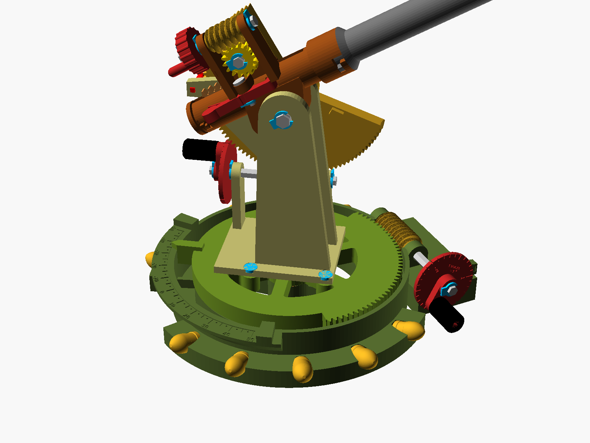
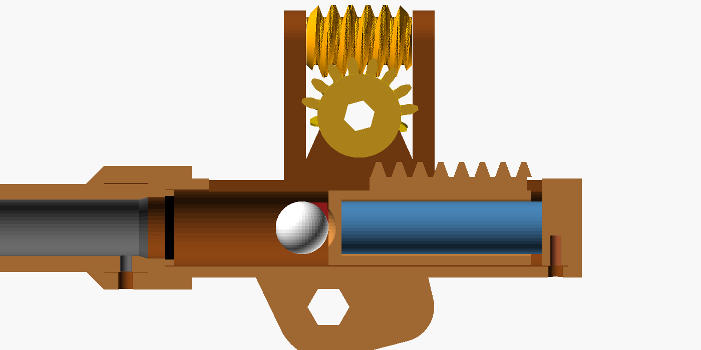
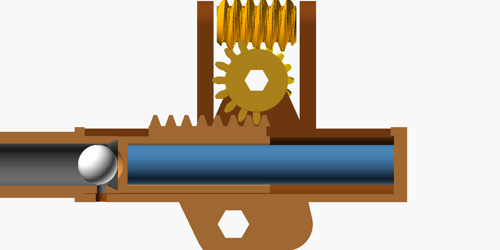

# Canhão de brinquedo v6: coroas em setor, base em bandeja, pontaria 120:1 (3° por volta) e só 2 itens para comprar

Arquivo único: [`artilharia.scad`](artilharia.scad), 100% paramétrico, ASCII puro e sem bibliotecas externas.
Os STLs prontos de todas as peças estão em [`stl/`](stl/), e tudo junto em `canhao_completo.zip`.

**Para comprar, só 2 itens:**
- **~52 BBs de airsoft de 6 mm**: são as esferas do rolamento da mesa.
- **1 mola de compressão 1,0 × 12 × 100 mm**.

Todo o resto é impresso: rolamento, rebites, baionetas, pinos, eixos e travas. Não há nenhum parafuso nem rosca em plástico para espanar.

## Pontaria

| Eixo | Acionamento | Redução | 1 volta da manivela | Números do tambor | 1 marca do tambor |
|---|---|---|---|---|---|
| **Azimute** | rosca sem fim → mesa = setor de coroa (passo de 120 dentes), módulo 1,25 (Ø152) | 120 : 1 | **3°** | **1° a cada 1/3 de volta** | 0,1° |
| **Elevação** | rosca sem fim → setor de coroa (passo de 120 dentes), módulo 1 (Ø122) | 120 : 1 | **3°** | **1° a cada 1/3 de volta** | 0,1° |

| Eixo | Curso útil | Batente | Dentes que sobraram |
|---|---|---|---|
| **Azimute** | **−50° a +50°** (giro total de 100°) | ressalto da mesa bate em 2 blocos da base a ±52° | arco de 120° (41 dentes) |
| **Elevação** | **−20° a +85°** (dá para atirar para baixo) | ressaltos da coroa batem no carro a −22° e +87° | arco de 220° em volta do eixo |

**Por que a coroa não "solta" no fim do curso:** o batente fica **antes** do último dente. No azimute, o setor
tem dentes até ±60°, mas o batente para a mesa em ±52°. No fim do curso, a rosca ainda está engrenada com
**8° de dentes de sobra** (cerca de 2,7 dentes) de cada lado. Na elevação, o batente para em −22°/+87°, e a
rosca continua no meio dos dentes. Se você forçar a manivela no batente, ela só para, porque a rosca não
consegue pular para fora da coroa.

**Leitura em duas etapas, como num micrômetro:**
1. **Escala grande:** número a cada 10°, traço a cada 5°, ponto a cada 2,5°. No azimute, a escala de −50 a +50
   agora é **fixa na aba da base**, e o ponteiro é a ponta do ressalto da mesa, que passa por cima da parede.
   Na elevação, a escala continua na coroa.
2. **Tambor da manivela** (Ø44): o número 0 fica no braço, e os números 1 e 2 a cada 1/3 de volta (cada um vale 1°).
   Os traços médios marcam 0,5° e os curtos 0,1° (30 marcas por volta). Está gravado **"1 VOLTA = 3°"**. A seta do mancal externo é o índice.

Exemplo: o ponteiro está entre o ponto de 32,5° e o traço de 35°, e o tambor mostra "1" mais 3 traços curtos.
A leitura é 32,5° + 1,3° = **33,8°**. Uma volta inteira da manivela soma 3°. Para ir de 0° a 45° são 15 voltas.

**Travas dos eixos:** são travas em "E" impressas (`trava_6` e `trava_8`). Você encosta a boca da trava no
canal do eixo e empurra de lado. Ela abre um pouco, estala no canal e não sai mais sozinha. Para tirar,
empurre pela aba. Cada eixo tem 2 ou 3 canais, e o punho da manivela também tem a sua trava.

**Manivelas:** cada uma tem 3 mancais (o externo afasta a manivela de tudo), um tambor graduado e um **punho em capa**.
A capa é fechada em cima e encaixa no pino com um **clique**: a ponta do pino é bipartida e tem um dente cônico,
que entra num canal interno da capa. Depois disso ela **não sai mais**, mas **gira solta**, porque o dente fica folgado no canal.

## Lançador de mola

*Corte armado: o pistão (laranja) está recuado e a mola (azul) comprimida. A bolinha está carregada e a parte lisa do pinhão encara a cremalheira.*

**Mola (AliExpress):** mola de compressão de aço, **fio 1,0 mm × Ø externo 12 mm × 100 mm**.
Procure por "compression spring 1.0 x 12 x 100". Se só achar mais longa, corte. A mola trabalha dentro do pistão,
apoiada numa guia na tampa, com pré-carga de ~20 mm e ~55 mm comprimida quando armada (~25–30 N).

**Projétil:** bolinha de **12 mm** (impressa, EVA ou isopor). Ela é carregada **pela boca do cano**, como num
canhão antigo, e rola até o pistão. Com o cano na horizontal, empurre com o `soquete`.

### Como funciona

1. **Armar:** o **volante de armar** (Ø28, com pino para girar com o dedo) fica atrás, na esquerda, com o eixo paralelo ao cano.
   Ele gira uma **rosca sem fim
   (16:1, autotravante)**, que gira uma coroa e um **pinhão "mutilado"**. Esse pinhão tem 8 dentes de um lado e é liso do outro,
   como o setor de um gearbox de airsoft. O pinhão puxa a **cremalheira** que fica no topo do pistão, comprimindo a mola.
2. **Clique:** quando o pistão chega a 35 mm de recuo, a **lingueta do gatilho** estala na frente dele.
3. **PRONTO:** continue girando cerca de **2 a 5 voltas**, até a faixa gravada na coroa de armar passar sob a seta.
   Nessa faixa a parte lisa do pinhão encara a cremalheira e o caminho fica livre. São 16 voltas por disparo no total.
4. **Disparar:** aperte o **botão do gatilho** (na esquerda, atrás) para dentro. O dente sai, a mola empurra o pistão
   e o pistão empurra a bolinha.

> Não gire além da faixa PRONTO. Se girar demais, o pinhão volta a pegar a cremalheira e trava contra a tampa.
> Basta voltar uma volta.

### Por que a pontaria não sai do lugar ao armar e disparar

- **A força da mola fecha dentro da culatra:** a mola fica entre o pistão e a tampa, na mesma peça.
  Ela não empurra nem o carro nem a mesa.
- **As roscas de pontaria são autotravantes.** O avanço é de 4–5°, e tan γ < μ. Nenhum esforço que chega às coroas consegue girar
  as roscas de volta. Só a sua mão, pela manivela, move a pontaria.
- **O volante de armar tem o eixo paralelo ao cano.** O torque da sua mão gira o cano em torno do próprio eixo,
  e não em elevação.
- **A rosca de armar também é autotravante.** Soltar a manivela no meio do caminho não dispara nem volta.

### Cortes

| Repouso | Armado |
|---|---|
|  |  |

## Projéteis

Formato de granada de morteiro: **corpo cilíndrico curto + ogiva tangente curta** (Ø12,5 × 22 mm), com a ponta
levemente achatada e base plana chanfrada. A base é onde o pistão empurra, e o chanfro ajuda a entrar no funil do cano.

- **Desliza sem vibrar:** tem **duas cintas de guia**, na frente e atrás, com 0,15 mm de folga por lado na alma de 12,8 mm.
  O meio é rebaixado 0,4 mm, então só as cintas tocam o cano. Com pouco atrito e dois apoios afastados, ele não
  "dança" no tubo e sai alinhado.
- **Caminho conferido no CGAL:** o projétil passa livre apoiado no pistão armado, sem tocar no dente do gatilho,
  depois pelo degrau, pelo funil e por todo o cano.
- **Cartucheiras na base:** a própria base guarda **10 projéteis** numa **saia baixa** (16 mm) rente ao anel.
  Eles ficam deitados a 25° e apontando para fora, espalhados por toda a lateral: 5 do lado +Y (de 40° a 140°)
  e 5 do lado −Y (de 200° a 300°, livre da manivela de azimute).
  Cada um entra 13 mm. **A ogiva fica inteira para fora**, e você pega de lado com dois dedos.
  O espaçamento é o mesmo nos dois lados: **25° entre projéteis**.
  Como estão inclinados para cima, a gravidade os mantém no lugar. A saia fica abaixo da mesa giratória.
- **Porta-munição avulso:** a peça `porta_projeteis`, bandeja com 6, continua disponível se você quiser guardar mais.

| Impressão do projétil | Peso | Saída (ideal) | Energia |
|---|---|---|---|
| 2 paredes, 15% | 1,2 g | ~12,6 m/s | 0,10 J |
| **3 paredes, 20% (recomendado)** | **1,7 g** | **~12,3 m/s** | **0,12 J** |
| maciço | 2,7 g | ~11,5 m/s | 0,18 J |

**Por que a velocidade quase não muda:** o pistão (~7 g) leva quase toda a massa em movimento. Um projétil
mais pesado sai só um pouco mais devagar, mas com **mais energia**, e sofre menos com o ar. Com atrito, os valores reais
ficam uns 20–30% abaixo. Os projéteis imprimem em pé, com a ponta para cima e sem suporte.
Para lixar as cintas, se ficarem justas, gire o projétil entre os dedos com uma lixa 400.

## Imprimindo em PETG: folgas, encaixes e pontos críticos

### Folgas (parâmetros no topo do `.scad`)

| Parâmetro | Valor | Onde | Se travar |
|---|---|---|---|
| `folga` | 0,25 mm | eixo sextavado em furo sextavado (rosca, coroa, cubos) | 0,30 |
| `folga_gira` | 0,40 mm (Ø) | eixo sextavado girando em furo redondo (mancais, bochechas) | 0,50 |
| `folga_desl` | 0,25 mm (Ø) | pistão no cilindro; quilha no rasgo (0,2 mm por lado) | 0,35 |
| `folga_ax` | 0,15 mm | **rosca encostada nos mancais** (sem jogo axial) | 0,25 |
| `folga_dente` | 0,12 mm | entre os dentes (backlash) | 0,18 |

Teste antes de imprimir tudo: imprima `trava_6`, `eixo_el`, `rosca_el` e `manivela_el`.
Se o eixo entrar sem forçar e a trava estalar, as folgas estão boas para a sua impressora.

### O que foi reforçado nesta revisão

| Ponto | Problema | Solução |
|---|---|---|
| **Roscas sem fim** | ficavam com 1 mm de jogo de cada lado e podiam escorregar no eixo. Cada 1 mm de deslize gira a coroa sem mexer na manivela: **~0,85° no azimute** | a rosca agora encosta nos mancais (0,15 mm), que funcionam como **mancal de empuxo** |
| **Batente do pistão** | o pistão (~7 g a ~13 m/s) para em menos de 1 mm, gerando **centenas de N** de pico a cada tiro. O tampão do cano preso por 1 M3 numa parede de 2,5 mm ia rachar | o batente agora é um **degrau interno da culatra**, com o **anel `amortecedor`** (TPU de preferência; em PETG serve de espaçador). O cano não leva mais a pancada |
| **Tampa traseira** | era fixa, e o pistão entrava pela frente | **tampa removível com baioneta em J** (2 ressaltos de 3 mm; ~3,6 MPa com a mola). O pistão entra por trás |
| **Pino do punho** | Ø6 impresso em pé: a mão força o pino entre as camadas (~19 MPa) e ele quebra na raiz | **Ø8** (~8 MPa); a fenda do clique fica só na ponta, onde o esforço é pequeno |
| **Elevação sem fim de curso** | com 90:1, insistir na manivela gera até ~4 N·m na coroa e pode esmagar a culatra ou cisalhar dentes | **batentes em −12° e 82°**: 2 ressaltos na face interna da coroa batem num bloco da bochecha |
| **Gatilho** | 4 mm de espessura sob carga constante (~22 MPa com a mola armada): o PETG flui e a lingueta entortaria com o tempo | **6 mm** e dente de 5 mm (~10 MPa). Gira num **pino impresso de Ø4** com `trava_4`, e a mola de lâmina ficou mais longa (deforma <1%, não perde a força) |
| **Cubos e eixos** | os canais das travas reduzem o sextavado para Ø4,6 | torção ~15 MPa com a mão forçando: aceitável |

### Pontos que continuam merecendo atenção

- **Rosca de armar** (impressa em pé): o filete trabalha **entre camadas**. Use 4+ paredes, 100% de preenchimento,
  240–250 °C e ventoinha em 30–50% para a camada colar bem.
- **Dentes da coroa de elevação (módulo 1):** aguentam ~160 N. Os batentes limitam o esforço, mas **não force a manivela quando ela parar**.
- **Lingueta do gatilho com o canhão armado por muito tempo:** o PETG flui sob carga constante. Não deixe armado por dias. Arme, atire e desarme.
- **Culatra:** imprima com a frente para baixo, com suportes nas placas e nos mancais externos, e 4 paredes.
- **PETG em PEI liso** pode arrancar o revestimento da placa. Use cola bastão ou PEI texturizado.
- Os outros pontos (rolamento, mesa e eixos sob carga de pontaria) trabalham com tensões baixas, abaixo de 5 MPa.

### Dica de artilheiro (para eliminar a folga dos dentes)

Toda engrenagem tem folga. Para a leitura ser repetível, **sempre chegue no ângulo girando no mesmo sentido**.
Por exemplo, sempre subindo. Se passou, volte meia volta e chegue de novo pelo mesmo lado. É assim que se aponta
artilharia de verdade. Na elevação, o próprio peso do cano já encosta os dentes sempre do mesmo lado.

## Peso em PETG (1,27 g/cm³)

"Típico" significa 3 paredes de 0,4 mm, topo e fundo de 1,2 mm e 20% de preenchimento giroide.
A estimativa usa volume e área de cada STL (±15%).

| Peça | Maciço | Típico |
|---|---|---|
| base (anel oco, saia com 10 projéteis, plataforma) | 445 g | **~217 g** |
| mesa (coroa de 120 dentes com janelas) | 172 g | **~101 g** |
| carro | 134 g | ~80 g |
| 2 anéis de pista | 52 g | ~44 g |
| coroa de elevação (120 dentes) | 129 g | ~66 g |
| culatra + cano | 84 g | ~61 g |
| 10 projéteis | 28 g | ~17 g |
| todo o resto (roscas, manivelas, eixos, rebites, travas…) | 122 g | ~101 g |
| **Total impresso** | **~1170 g** | **~690 g** |
| + BBs e mola | | ~11 g |

Antes desta revisão, a base e a mesa eram maciças: 651 g + 209 g (~313 g no típico).

**Por que o "típico" cai menos que o "maciço":** na impressão FDM, o miolo já é preenchimento ralo, e quem
pesa são as paredes. Tirar volume ajuda muito no maciço. No típico, o que mais pesa é a área de superfície.
- **Para pesar menos:** imprima a base e o carro com **2 paredes e 10–15%** (dá uns 130 g a menos).
- **Mantenha 4 paredes e 100%** nas peças que trabalham: roscas, pinhão, gatilho, travas e punhos.

### Base em bandeja (v6)
- **Mais baixa:** a mesa agora fica a 20 mm da mesa da sala (antes eram ~35 mm). O punho da manivela de azimute fica ~4 mm acima do chão.
  Centro de gravidade mais baixo = canhão mais estável.
- **Bandeja:** o setor de dentes da mesa corre **dentro** da base, entre um piso de 3 mm e uma **parede** em volta
  (2 mm de folga radial). A parede protege os dentes, endurece a base como a borda de uma assadeira, e é nela que ficam os batentes.
- **Rígida sem ser maciça:** o anel da pista (paredes de 2 mm e teto em V) se liga ao cubo central por 4 raios e à parede por 6 nervuras.
- **Aba da escala:** só do lado de trás (±62°), com apoio a 45° para imprimir sem suporte.
- **Sem anel por cima:** a mesa continua só apoiada nas BBs. O peso do cano e do carro a mantém no lugar, e os blocos de batente seguram o giro.
- **Plataforma da manivela:** tem um vão em V por baixo, e a rosca entra na bandeja por uma janela da parede.

## Sem nada comprado além das BBs e da mola

### Rolamento impresso (substitui o 608)
A pista da mesa são **dois anéis impressos** (`anel_pista_base` e `anel_pista_mesa`), com um canal em V de 90°.
As **BBs de 6 mm** rolam entre eles.
- **Encaixe:** o anel de baixo tem **8 dentes para baixo**, que entram em rasgos da base. O de cima tem **8 dentes para cima**,
  que entram em rasgos da mesa. Assim os anéis não giram nem saem do centro, e a folga no assento é de 0,15 mm.
- **Por que dispensa o 608:** uma esfera presa entre dois canais em V funciona como um **rolamento de contato angular**.
  Ela segura o peso e também **centraliza** a mesa. O `pino_pivo` passa folgado (Ø8 num furo de Ø8,8) e serve só de guia
  na montagem.
- **Se gastar:** depois de muito uso, imprima só os dois anéis de novo.

### Sem parafusos
| Onde era parafuso | Agora | Por que não espana |
|---|---|---|
| Carro → mesa (4) | **`rebite`** de pressão: haste bipartida com dente que estala num rebaixo por baixo da mesa | trabalha ao cisalhamento e não tem rosca |
| Tampa traseira (2) | **baioneta em J**: encaixe, empurre, gire 30° e solte. A mola puxa os ressaltos para o entalhe | é a própria mola que trava a tampa |
| Cano (1) | **baioneta**: encaixe até o colar e gire 30°. Há um aperto de 0,05 mm no fim do curso | o cano quase não leva esforço: a pancada fica no degrau da culatra |
| Pivô do gatilho (1) | **`pino_gatilho`** de Ø4 com **`trava_4`** | o pino só leva cisalhamento (~27 N) |

**Desmontar os rebites:** tire a mesa da base, porque ela só está apoiada nas BBs. Aperte as duas pernas do rebite
por baixo com um alicate de bico e empurre para cima.

## Peças (troque `PARTE` no Customizer)

Cada peça já sai na orientação de impressão.

| Grupo | Peças |
|---|---|
| Base e mesa | `base`, `mesa`, `anel_pista_base`, `anel_pista_mesa`, `pino_pivo`, `rebite` ×4 (o `ponteiro_az` saiu: agora o ponteiro faz parte da mesa) |
| Carro | `carro`, `ponteiro_el`, `roda_el` |
| Pontaria | `rosca_az`, `rosca_el`, `manivela_az`, `manivela_el`, `eixo_az`, `eixo_el`, `eixo_munhao` |
| Lançador | `culatra` (frente para baixo, com suportes), `tampa`, `amortecedor` (TPU), `pistao`, `cano`, `pinhao_armar`, `coroa_armar`, `rosca_armar`, `volante_armar`, `eixo_pinhao`, `eixo_armar`, `gatilho`, `pino_gatilho`, `soquete`, `projetil` (×10 para encher as cartucheiras), `porta_projeteis` |
| Pequenas | `punho` ×2 (capas de encaixe), `trava_4` ×1, `trava_6` ×11, `trava_8` ×2 (imprima algumas a mais de cada) |

**Comprar:** ~52 BBs de 6 mm e 1 mola 1,0×12×100. Mais nada.

**Imprima os anéis de pista e os rebites com 4 paredes e 100%.**

## Montagem (resumo)

1. **Rolamento:** encaixe o `anel_pista_base` na base (canal para cima, dentes nos rasgos) e o `anel_pista_mesa`
   embaixo da mesa (canal para baixo). Espalhe ~52 BBs no canal e pouse a mesa. Passe o `pino_pivo` pelo centro.
2. **Rosca de azimute:** passe o eixo pelos 3 mancais, depois encaixe as travas e a manivela.
3. **Carro:** encaixe o carro na mesa com os 4 rebites (empurre até estalar) e monte a rosca de elevação.
4. **Lançador:**
   - Ponha o `amortecedor` no fundo (frente) do cilindro.
   - Encaixe o cano no soquete, empurre até o colar e gire 30°.
   - Coloque o pistão **por trás**, com a quilha no rasgo de cima, e a mola dentro dele.
   - Feche a `tampa`: encaixe os ressaltos, empurre, gire 30° e solte.
   - Monte o pinhão, a coroa e o eixo, depois a rosca de armar e o volante.
   - Por último, o gatilho: passe o `pino_gatilho` por cima da orelha e prenda com a `trava_4` por baixo.
5. **Cano no carro:** coloque a culatra entre as bochechas e a coroa de elevação do lado de fora. Passe o eixo do munhão e as travas.

## Verificações feitas (CGAL)

Todas as peças geram sólido válido. Também conferi:
- Pinhão e cremalheira, pistão em todo o curso, gatilho, rosca e coroa de armar: sem colisão.
  A única exceção é o contato esperado da lingueta, que o pistão empurra para fora quando está em repouso.
- O disparo passa livre pelo pinhão em toda a janela PRONTO.
- As roscas engrenam com as coroas de azimute e elevação sem se interpenetrar.
- As manivelas giram livres, e o volante de armar dá a volta completa. Ele substituiu uma manivela comprida que,
  perto de 82° de elevação, batia na manivela de elevação.
